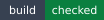

<!-- markdownlint-disable MD013 MD033 -->
<!-- This file is generated by Paradox. Do not edit manually. -->

# @ankhorage/scraper

        

Safe, bounded browser observations for public websites.

## Usage

### CLI

Ankhorage packages expose their command-line interface through `ankh`. Use `ankh --help` to discover available package commands, or run a package command with `--help` for package-specific usage.

```zsh
# Install the Ankhorage CLI
bun add --global @ankhorage/ankh

# Show usage information for scraper
ankh scraper --help
```

### Crawl a website

Crawl a public website into the portable website-observation contract.

```ts
import { createWebsiteCrawler } from '@ankhorage/scraper';
```

## Generated documentation

- [Interactive documentation app](././paradox/index.html)
- [Public API reference](././paradox/exports.md)
- [Component registry](././paradox/components.md)
- [Architecture overview](././paradox/diagrams/architecture-overview.mmd)
- [Module relationships](././paradox/diagrams/module-relationships.mmd)
- [Export graph](././paradox/diagrams/export-graph.mmd)
